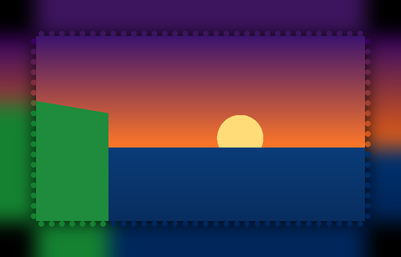

# ScreenGlow 🌈

**Ambient LED lighting that follows the colours on your screen.** Stick an LED strip on the back of your monitor, run ScreenGlow, and the wall behind it glows with whatever is on screen. It looks great for movies and games and is easier on your eyes in a dark room.



*The built-in preview: a virtual LED strip around a mini copy of your screen. Try it before buying any hardware.*

## How it works

```
 ┌──────────┐   capture    ┌──────────────┐  colour   ┌──────────────┐  Wi-Fi (UDP)  ┌─────────────┐
 │  Screen  │ ───────────► │ sample edges │ ────────► │ smooth, gamma│ ────────────► │ ESP32 + WLED│ ─┐
 └──────────┘  ~25 fps     │ per LED zone │  maths    │ power limit  │  or USB serial│ or Arduino  │  │
                           └──────────────┘           └──────────────┘ ────────────► └─────────────┘  ▼
                                                                                              WS2812B strip
```

1. **Capture**: grabs the screen with `mss` and downscales it to about 480 px wide (fast, and fine detail doesn't matter for a glow).
2. **Sample**: each LED owns a zone along the screen edge; ScreenGlow averages the colour in that zone ([`layout.py`](screenglow/layout.py)).
3. **Colour processing** ([`colour.py`](screenglow/colour.py)):
   - *saturation boost* so colours look vivid on a white wall,
   - *smoothing* (exponential moving average) so scene cuts fade instead of flicker,
   - *gamma correction*, because screens are gamma-encoded but LEDs are linear, so dark scenes stay dark,
   - *power limit*, which estimates the strip's current draw and dims it so it never overloads your power supply.
4. **Output** ([`outputs.py`](screenglow/outputs.py)): WLED's realtime UDP protocol (ESP32 over Wi-Fi) or the Adalight serial protocol (Arduino over USB).

## Quick start (no hardware)

```bash
git clone https://github.com/memoriesrohit/screenglow
cd screenglow
python -m venv .venv
.venv\Scripts\activate          # Windows  (macOS/Linux: source .venv/bin/activate)
pip install -e .
screenglow --preview
```

Play a video or move a colourful window around, and the virtual strip follows it.

## Hardware

| Part | Notes | Approx. (INR) |
|---|---|---|
| WS2812B LED strip, 5 V, 60 LEDs/m | measure the back of your monitor; a 24" needs about 1.7 m | ₹700–1,000 |
| 5 V power supply | 4 A is enough for ~100 LEDs with `--max-amps 3.5` | ₹300–400 |
| ESP32 **or** Arduino Uno/Nano | ESP32 = wireless, Arduino = USB | ₹350 |
| 330 Ω resistor, 1000 µF capacitor, DC jack, wires | resistor on data, capacitor across 5 V/GND | ₹100 |

**Wiring:** power supply 5 V → strip 5 V, power supply GND → strip GND **and** board GND (a shared ground is required), board data pin → 330 Ω → strip DIN. Put the 1000 µF capacitor across 5 V/GND at the strip. Don't power the strip from the board's 5 V pin.

### Option A: ESP32 + WLED (wireless, recommended)

1. Flash [WLED](https://kno.wled.ge/) onto the ESP32 from the browser installer and connect it to your Wi-Fi.
2. In WLED: *Config → LED Preferences*, set the LED count and data pin.
3. Run:
   ```bash
   screenglow --wled 192.168.1.50 --preview
   ```
   When ScreenGlow stops, WLED goes back to its normal effect after 2 seconds.

### Option B: Arduino + USB

1. Open [`firmware/adalight/adalight.ino`](firmware/adalight/adalight.ino), install the **FastLED** library, set `NUM_LEDS` and `DATA_PIN`, and upload.
2. Run:
   ```bash
   pip install -e ".[arduino]"
   screenglow --adalight COM5
   ```
   At 115200 baud an Uno handles about 100 LEDs at 30 fps.

## Setting it up for your strip

Count the LEDs on each side and pass them as `--leds LEFT TOP RIGHT BOTTOM`. Then run the wiring test:

```bash
screenglow --wled 192.168.1.50 --leds 18 32 18 32 --test
```

LED 0 lights **red**, the last LED **blue**, and a white dot runs along the strip. ScreenGlow assumes, as seen **from the front**, that LED 0 is at the bottom-left corner and the strip runs clockwise.

- If the dot runs counter-clockwise, add `--reverse`.
- If the red LED isn't at the bottom-left, use `--offset N`, where N is how many LEDs (clockwise from bottom-left) the red one actually sits at.

## All options

| Option | Default | What it does |
|---|---|---|
| `--leds L T R B` | `18 32 18 32` | LEDs per side |
| `--brightness` | `0.7` | overall brightness, 0–1 |
| `--smoothing` | `0.6` | 0 = instant, 0.9 = slow, calm fades |
| `--saturation` | `1.2` | >1 = more vivid colours |
| `--gamma` | `2.2` | LED gamma correction |
| `--max-amps` | `3.5` | dims output to stay under your PSU's current |
| `--depth` | `0.08` | how far into the screen each LED samples |
| `--monitor` | `1` | which screen to capture |
| `--fps` | `30` | target frame rate |

## Known limitations

- **Protected video** (Netflix/Prime in some browsers) can show as black to screen capture, so the LEDs go dark for that content. YouTube, games and local videos work.
- Capture runs at about **20–30 fps** on a high-resolution laptop screen (it's limited by Windows screen capture, not the maths). With smoothing on, that's plenty for ambient light.
- The preview window is on your screen too, so keep it away from the edges or it will see itself.

## Development

```bash
pip install -e ".[dev]"
pytest
```

```
screenglow/
  layout.py    LED positions + edge sampling
  colour.py    saturation, smoothing, gamma, power limit
  outputs.py   WLED UDP + Adalight serial
  preview.py   virtual LED window (tkinter)
  cli.py       command line + main loop
firmware/adalight/adalight.ino   Arduino receiver
tests/                           pytest suite
```

## Ideas for next versions

- Music mode: react to system audio instead of the screen
- Auto-detect letterbox black bars in films
- A small tray app with sliders instead of command-line options

## License

MIT, by [Rohit Biradar](https://github.com/memoriesrohit)
